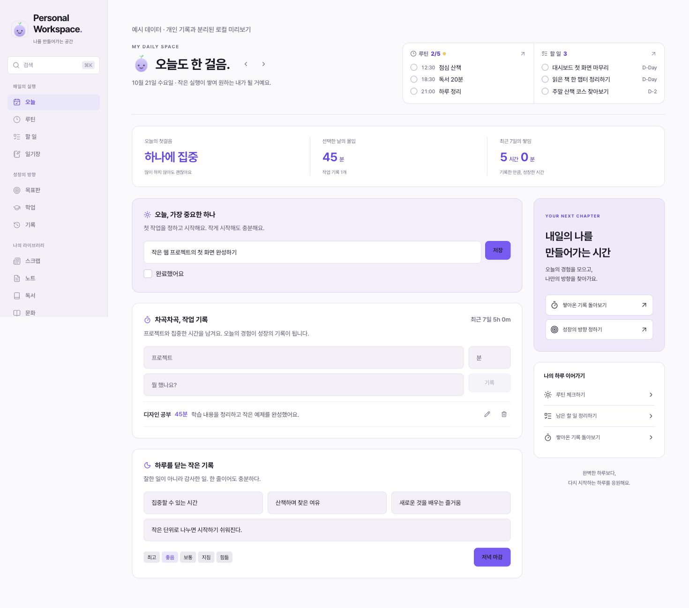
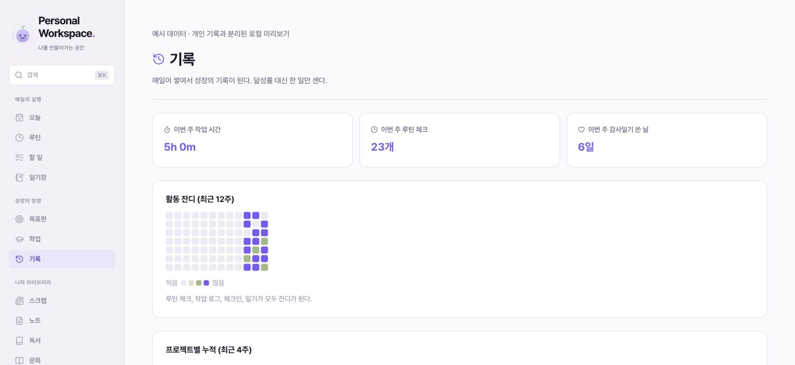

# Personal Workspace

[English](README.md) · [설치 가이드](docs/INSTALLATION.md) · [기여 가이드](CONTRIBUTING.md)

오늘의 계획, 루틴, 메모, 그리고 실제로 해낸 일을 한곳에 모으는 개인 워크스페이스입니다. 하루의 우선순위를 정하고 작업을 기록하면서, 목표·학업·독서·아이디어를 같은 공간에서 이어갈 수 있습니다.

Personal Workspace는 Yeji OS에서 일상 관리 기능을 분리한 독립 저장소입니다. 기존 앱의 디자인과 일상 흐름을 유지하면서 개인 데이터가 없는 상태로 시작합니다. **앱 화면은 의도적으로 한국어를 유지**하며, 저장소 문서는 영어와 한국어로 제공합니다.



## 이런 용도로 사용할 수 있어요

- **하루를 한 화면에서 정리합니다.** 남은 루틴과 할 일을 보고, 우선순위를 정하고, 작업 시간을 기록한 뒤 감사와 짧은 회고로 마무리합니다.
- **실행을 성장의 방향과 연결합니다.** 목표판과 학업 기록 옆에서 실제로 쌓인 활동을 돌아봅니다.
- **나만의 라이브러리를 만듭니다.** 노트, 링크, 책, 문화생활, 여행, 콘텐츠 아이디어를 각각 다른 앱에 흩어두지 않고 모읍니다.
- **계정이나 API 키 없이 로컬에서 시작합니다.** 기록은 로컬 JSON 파일에 저장합니다. 호스팅된 데이터베이스가 필요해지면 자신의 Supabase 프로젝트를 연결합니다.
- **자신에게 맞게 바꿉니다.** 소스 코드, 컬렉션 정의, 디자인 토큰, 목표판의 초기 구조를 함께 제공합니다.

한 명의 소유자를 위한 앱입니다. 배포한 앱의 패스코드를 아는 사람은 모두 같은 워크스페이스를 사용합니다. 사용자별 계정, 팀 권한, 공동 편집 기능은 제공하지 않습니다.

## 포함된 기능

사이드바는 세 영역으로 구성합니다. **기록**은 **성장의 방향**에 배치되어 있습니다.

| 영역 | 화면 | 할 수 있는 일 |
| --- | --- | --- |
| 매일의 실행 | 오늘 | 하루의 우선순위 정하기, 루틴·할 일 체크, 프로젝트별 작업 시간 기록, 기분·감사·배운 점 작성, 날짜별 돌아보기 |
| 매일의 실행 | 루틴 | 시간·색상·설명이 있는 루틴 추가·수정·삭제, 선택한 날짜의 완료 체크 |
| 매일의 실행 | 할 일 | 마감일·우선순위·카테고리·완료 상태 관리, 지연·오늘·예정·기한 없는 할 일 확인 |
| 매일의 실행 | 일기장 | 날짜별 일기 작성, 텍스트 서식과 이미지 첨부 |
| 성장의 방향 | 목표판 | 인생 다짐, 네 개의 방향 카드, 만다라트 목표판 수정 |
| 성장의 방향 | 학업 | 과정, 주차별 수업 노트, 과제·시험 마감 관리 |
| 성장의 방향 | 기록 | 이번 주 합계, 최근 12주 활동 잔디, 최근 4주 프로젝트별 시간과 일별 기록 확인 |
| 나의 라이브러리 | 스크랩 | 링크·키워드·날짜·메모 저장, 스크랩과 딥다이브 구분 |
| 나의 라이브러리 | 노트 | Inbox·Project·Area·Resource·Archive의 PARA 분류로 노트 정리 |
| 나의 라이브러리 | 독서 | 독서 상태·장르별 책장, 독서 기록·인용·감상 관리 |
| 나의 라이브러리 | 문화 | 책·공연·영화·방송 등 문화생활과 관심 목록 기록 |
| 나의 라이브러리 | 여행 | 가고 싶은 곳, 계획 중인 여행, 다녀온 곳 정리 |
| 나의 라이브러리 | 콘텐츠 | 콘텐츠 아이디어, 업로드 상태, 운영 채널과 참고 계정 관리 |

라이트·다크 테마, 데스크톱 사이드바, 모바일 내비게이션, `⌘K` / `Ctrl+K` 페이지 이동 창도 제공합니다. 페이지 이동 창은 메뉴를 검색하며, 저장한 기록의 본문을 검색하는 기능은 아닙니다.

위키, 구직 관리, 포트폴리오 페이지는 이 저장소의 범위에서 제외했습니다.

## 하루 사용 예시

1. **오늘**에서 가장 먼저 끝내고 싶은 일을 하나 적습니다.
2. **할 일**에 작업을, **루틴**에 반복할 행동을 추가합니다. 오늘 화면으로 돌아와 진행한 항목을 체크합니다.
3. 프로젝트 이름, 작업 시간, 짧은 메모를 남깁니다. 하루를 마무리하며 감사한 일, 기분, 배운 점을 기록합니다.
4. **기록**에서 쌓인 활동을 확인합니다. **목표판**과 **학업**을 보며 다음에 집중할 일을 정합니다.



스크린샷에는 가상 데모 기록을 사용했습니다. 일반 설치는 개인 기록이 없는 상태로 시작합니다.

## 빠르게 시작하기

**Node.js 22.13.0 이상**, npm, Git이 필요합니다. 명령어는 macOS·Linux 또는 Windows의 WSL에서 사용하는 POSIX 셸을 기준으로 합니다.

```sh
git clone https://github.com/dpwld/personal-workspace.git
cd personal-workspace
npm ci
npm run dev
```

[http://127.0.0.1:3000](http://127.0.0.1:3000)을 엽니다. 할 일이나 노트를 하나 저장한 다음 새로고침해서 기록이 유지되는지 확인합니다.

환경변수를 설정하지 않으면 개발 서버는 루프백 주소에서 실행하며 `.data/dev.json`에 기록을 저장합니다. 기본 로컬 사용에는 Supabase, VAPID 키, 별도 유료 서비스가 필요하지 않습니다. 같은 파일을 사용하는 앱 프로세스는 하나만 실행하세요.

선택 기능을 설정하려면 템플릿을 복사하고 필요한 항목만 입력합니다.

```sh
cp .env.example .env.local
```

[설치 가이드](docs/INSTALLATION.md)에서 운영 인증, 저장소, 이미지, 알림, 백업, 문제 해결을 자세히 설명합니다.

### 가상 데이터로 둘러보기

```sh
npm run demo:seed
npm run demo:dev
```

[http://127.0.0.1:4317](http://127.0.0.1:4317)을 엽니다. 데모는 일반 기록 파일인 `.data/dev.json`과 분리된 `.data/demo.json`을 사용합니다. 로컬 개발용 모드이며 공개 데모 배포용 기능은 아닙니다. 자신의 워크스페이스로 돌아가려면 `npm run dev`를 실행합니다. 예시 기록을 다시 만들려면 데모 서버를 멈추고 `npm run demo:clean`을 실행한 뒤 `npm run demo:seed`를 실행합니다.

## 사용 환경 선택

| 기능 | 로컬 개발 | 디스크가 유지되는 단일 서버 | 호스팅·서버리스 배포 |
| --- | --- | --- | --- |
| 기본 기록 | 로컬 JSON, 키 불필요 | 영구 쓰기 가능 디스크의 JSON 또는 자신의 Supabase | 자신의 Supabase |
| 인증 | 루프백에서는 선택 | `PASSCODE`, `APP_ORIGIN` 필수 | `PASSCODE`, `APP_ORIGIN` 필수 |
| 이미지 | 비공개 로컬 업로드 저장소 | 영구 로컬 저장소 또는 Supabase Storage | 비공개 Supabase Storage 버킷 |
| 책 표지 검색 | 인터넷 필요, 별도 키 설정 없음 | 동일 | 동일 |
| 링크 미리보기 | 허용할 출처를 선택 설정 | 허용할 출처를 선택 설정 | 허용할 출처를 선택 설정 |
| 루틴 푸시 알림 | 추가 설정 시 사용 | Supabase, VAPID 키, 브라우저 권한, 스케줄러 필요 | 동일하며 별도 예약 실행 환경 필요 |

로컬 파일 저장은 임시 파일시스템을 사용하는 서버리스 환경이나 여러 앱 인스턴스에 적합하지 않습니다. Supabase 환경변수를 추가해도 기존 JSON 기록을 자동으로 옮기지 않습니다.

## 환경변수 요약

설정 템플릿은 [`.env.example`](.env.example), 전체 설명은 [환경변수 참조](docs/INSTALLATION.md#environment-reference)에 있습니다.

| 환경변수 | 용도 |
| --- | --- |
| `PASSCODE` | 공유 워크스페이스 패스코드. 설정할 때는 16자 이상이어야 하며, 운영 환경에서는 필수입니다. |
| `APP_ORIGIN` | `https://workspace.example.com`과 같은 브라우저 접속 출처 전체. 운영 환경에서는 필수입니다. |
| `SUPABASE_URL` | 자신의 Supabase 프로젝트 URL. 서비스 키와 함께 설정합니다. |
| `SUPABASE_SERVICE_KEY` | 서버 전용 Supabase 서비스 키. `NEXT_PUBLIC_` 접두사를 붙이면 안 됩니다. |
| `WORKSPACE_DATA_DIR` | 영구 로컬 데이터 디렉터리 경로. 선택 사항이며 기본값은 `.data`입니다. |
| `OG_ALLOWED_ORIGINS` | 서버에서 링크 미리보기를 조회할 수 있는 HTTPS 출처 목록. 쉼표로 구분하며 선택 사항입니다. |
| `NEXT_PUBLIC_VAPID_PUBLIC_KEY` | 브라우저와 알림 발송 스크립트가 사용하는 공개 키. 선택 사항입니다. |
| `VAPID_PRIVATE_KEY`, `VAPID_SUBJECT` | 루틴 알림 발송용 비공개 키와 발신자 연락처. 선택 사항입니다. |

운영 환경에서는 패스코드를 입력한 뒤 서명과 만료 시간이 있는 세션 쿠키를 사용합니다. `PASSCODE`를 바꾸면 기존 세션은 무효가 됩니다. 이 인증은 하나의 공유 워크스페이스를 잠그는 방식이며, 여러 사용자의 계정을 관리하는 방식은 아닙니다.

### 선택 연동

**Supabase.** 자신의 프로젝트에 [`supabase/schema.sql`](supabase/schema.sql)을 적용하고 서버 환경변수 두 개를 설정합니다. 이미지를 사용하려면 비공개 `workspace-uploads` 버킷도 만듭니다. 데이터베이스는 앱 서버를 통해 접근하며 브라우저에 서비스 키를 전달하지 않습니다. [Supabase 설정](docs/INSTALLATION.md#how-to-use-your-own-supabase-project)을 참고하세요.

**책 표지.** 독서 화면은 Google Books에서 표지를 조회하고, 찾지 못하면 Open Library를 사용합니다. 입력한 책 제목과 저자를 해당 서비스로 전송합니다. 외부 서비스의 가용성, 수록 범위, 공개 API 사용량 제한에 따라 결과가 달라지며, 표지가 없어도 독서 기록은 저장할 수 있습니다.

**링크 미리보기.** `OG_ALLOWED_ORIGINS`를 설정하기 전에는 서버의 미리보기 조회가 비활성화됩니다. HTTPS 출처를 정확히 지정해야 하며 리디렉션을 따라가지 않습니다. 미리보기를 켜지 않아도 링크와 메모를 저장할 수 있습니다.

**푸시 알림.** 브라우저 권한만 허용해서는 발송되지 않습니다. 자신의 VAPID 키, Supabase에 저장되는 구독 정보, [`scripts/push-routines.mjs`](scripts/push-routines.mjs)를 실행할 스케줄러가 필요합니다. 저장소에서 스케줄러를 자동으로 만들지는 않습니다. [알림 설정](docs/INSTALLATION.md#how-to-enable-routine-notifications)을 참고하세요.

## 개발

Next.js App Router, React, TypeScript, Tailwind CSS, Lucide 아이콘, 공통 저장 계층을 사용합니다. 정확한 의존성 버전은 [`package.json`](package.json)과 [`package-lock.json`](package-lock.json)에 있습니다.

```sh
npm run dev
npm test
npm run typecheck
npm run build
npm run test:integration
```

통합 검사는 폐기 가능한 로컬 데이터를 사용해 루프백에서 운영 서버를 실행합니다. 빌드가 성공한 뒤 실행하며, 실제 Supabase 연결이나 푸시 전달까지 확인하는 검사는 아닙니다.

`npm start`는 빌드된 운영용 앱을 실행합니다. 먼저 운영 환경 설정을 준비해야 하며, 잠금 없이 사용하는 로컬 개발 동작은 운영 실행에 적용되지 않습니다.

| 경로 | 역할 |
| --- | --- |
| `app/` | 페이지, 레이아웃, 서버 API 경로 |
| `app/ds/` | 공통 디자인 스타일과 토큰 |
| `components/` | 내비게이션, 편집기, 드로어, 컬렉션 등 공통 UI |
| `lib/store.ts` | 로컬 JSON·Supabase 저장 처리 |
| `lib/types.ts` | 주요 데이터 형식과 서울 날짜 도우미 |
| `lib/collections.ts` | 컬렉션 이름, 입력 필드, 그룹 설정 |
| `lib/plan.ts` | 개인 기록이 없는 목표판 초기 구조 |
| `lib/routine-schedule.mjs` | 날짜별 루틴 선택 로직 |
| `supabase/schema.sql` | 테이블과 데이터베이스 접근 정책 설정 |
| `scripts/` | 데모 구성과 선택 알림 실행 스크립트 |
| `tests/` | 자동 검사 |
| `.data/` | Git에서 제외되는 로컬 기록과 실행 파일 |

앱을 수정하기 전에 [CONTRIBUTING.md](CONTRIBUTING.md)를 읽어주세요. 프레임워크 동작을 변경할 때는 설치된 Next.js 버전에 함께 제공되는 문서를 기준으로 확인합니다.

## 나에게 맞게 바꾸기

- 앱 이름과 설명은 `app/layout.tsx`, `app/manifest.ts`, `components/sidebar.tsx`에서 변경합니다.
- 색상, 간격, 테마는 `app/ds/`와 `app/globals.css`에서 조정합니다.
- `public/avatar.png`의 기본 새싹 마스코트를 원하는 사이드바 이미지로 교체할 수 있습니다. 파일을 제거하면 이니셜을 표시합니다.
- 컬렉션의 입력 항목은 `lib/collections.ts`와 해당 페이지의 클라이언트에서 수정합니다.
- 자신의 목표는 UI에서 편집합니다. 새 데이터셋의 초기 구성을 바꾸고 싶을 때만 `lib/plan.ts`를 수정합니다.
- 페이지를 추가하거나 제거할 때는 사이드바와 `components/quick-nav.tsx`를 함께 수정합니다.

날짜와 루틴 일정은 **Asia/Seoul**을 기준으로 하며, 공휴일 로직은 저장소에 포함된 한국 공휴일 데이터를 사용합니다. 다른 언어나 시간대로 바꾸려면 문구, 날짜 도우미, 일정 로직, 테스트를 함께 검토해야 합니다. 현재 UI에는 언어·시간대 선택 설정이 없습니다.

## 데이터 보관과 현재 범위

기록은 자신의 파일시스템이나 Supabase 프로젝트에 저장합니다. `.data/`와 환경변수 파일은 Git에서 제외합니다. 기록과 업로드 이미지를 함께 백업하세요. 소스 코드를 GitHub에 올리는 것만으로 개인 데이터가 백업되지는 않습니다.

원본 워크스페이스의 개인 기록, 인증 정보, 비공개 첨부 파일, 기존 Git 이력은 포함하지 않습니다. 데모 데이터는 명시적으로 생성하며 일반 로컬 기록과 분리합니다.

계정 복구, 사용자별 권한, 저장 모드 간 자동 동기화, 오프라인 쓰기 대기열은 제공하지 않습니다. 서비스 워커는 알림을 처리하며, 앱 전체를 오프라인으로 사용할 수 있게 하지는 않습니다.

## 문서와 기여

- [English README](README.md)
- [설치와 운영](docs/INSTALLATION.md)
- [기여 가이드](CONTRIBUTING.md)
- [환경변수 템플릿](.env.example)
- [데이터베이스 스키마](supabase/schema.sql)

버그를 제보할 때는 문제가 생긴 화면, 재현 순서, 기대한 결과, 실제 결과를 적어주세요. 스크린샷과 예시에는 가상 기록을 사용합니다.

## 라이선스

[MIT 라이선스](LICENSE)를 적용합니다. 저작권 표시와 허가 고지를 유지하면 상업적 사용을 포함하여 사용·수정·재배포할 수 있습니다. 외부 패키지와 에셋에는 각각의 라이선스가 적용됩니다.
